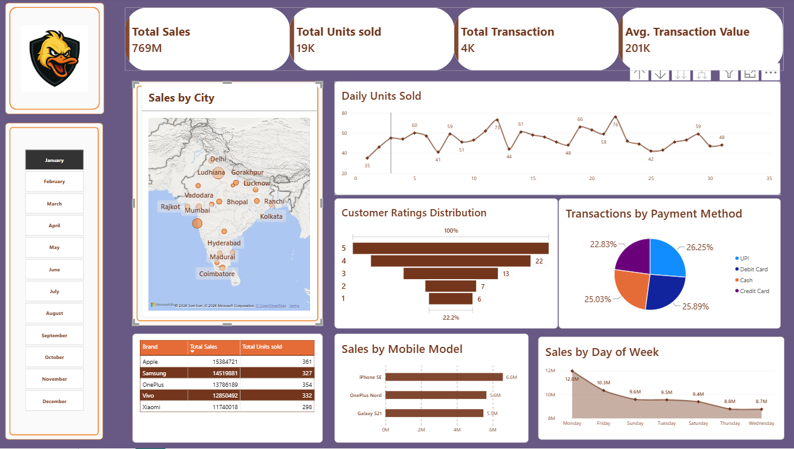

# 📱 Mobile Sales Analytics Dashboard (Power BI)

## 📌 Project Overview
This interactive Power BI dashboard analyzes mobile phone sales across major Indian cities from **2021 to 2024**. It provides insights into total revenue, unit volume, brand performance, payment preferences, and customer satisfaction.

## 📊 Dashboard Preview

## 🔑 Key Metrics & Insights
* **Total Sales:** 769M
* **Total Units Sold:** 19K
* **Total Transactions:** 4K
* **Average Transaction Value:** 201K
* **Top Performing Brands:** Apple, Samsung, and OnePlus lead in total revenue and units sold.
* **Payment Distribution:** Transactions are evenly balanced across UPI (26.25%), Debit Card (25.89%), Cash (25.03%), and Credit Card (22.83%).
* **Peak Sales Day:** Monday generates the highest revenue across the week.

## 📂 Repository Contents
* `Mobile_Sales_Dashboard.pbix` — The complete Power BI report file.
* `Mobile_Sales.csv` — Raw transactional dataset containing 3,835 records.
* `mobile_sales.png` — Visual snapshot of the main dashboard page.

## 🛠️ Tools Used
* **Microsoft Power BI Desktop** (Data Modeling, DAX, Data Visualization)
* **Microsoft Excel / CSV** (Data Storage & Preprocessing)
